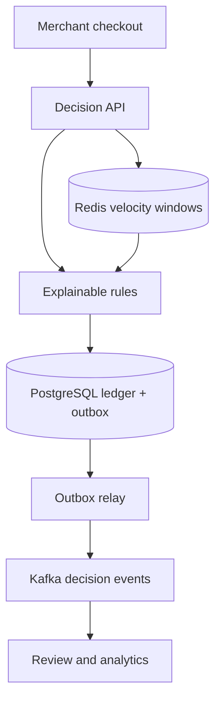

# Real-Time Fraud Decisioning Platform

A production-minded Java 17 service that makes explainable fraud decisions on the transaction path, persists immutable evidence, and reliably distributes decision events through Kafka.

[](https://github.com/ihrutvik/fraud-decisioning-platform/actions/workflows/ci.yml)


## Why recruiters should care

This repository demonstrates backend engineering beyond CRUD: tenant-scoped idempotency, deterministic risk scoring, auditable reason codes, transactional messaging, concurrency-safe workers, schema migrations, and failure-aware API design.

## Engineering highlights

| Production problem | Design response |
|---|---|
| A retried checkout must not create a second decision | Tenant-scoped idempotency plus canonical SHA-256 payload fingerprints |
| Database state and Kafka events must not diverge | Transactional outbox with concurrent PostgreSQL leasing |
| Velocity checks must work across replicas | Atomic Redis sorted-set windows implemented through Lua |
| Redis failure must not consume the checkout latency budget | Explicit degradation policy and closed/open/half-open circuit breaker |
| Fraud logic must remain explainable and reproducible | Stable reason codes and immutable rule-set versions on every decision |
| Candidate models must be evaluated safely | Shadow scoring with persisted comparison evidence and drift metrics |
| Human decisions must remain attributable | Exclusive analyst leases and immutable review audit history |
| Delayed outcomes must feed model validation safely | Idempotent verified-feedback ingestion with source-reference deduplication |

The repository is deliberately original portfolio code. It does not contain or reproduce proprietary employer implementations.

## Current capabilities

- `APPROVE`, `REVIEW`, or `DECLINE` decisions with bounded risk scores
- Explainable rules for country mismatch, transaction value, card-not-present, and account age
- Distributed account, device, and IP velocity rules using Redis sorted sets
- Atomic sliding-window updates through a server-side Lua script
- Configurable `FAIL_REVIEW` or `FAIL_OPEN` behavior during Redis outages
- Redis circuit breaker with configurable failure threshold, timed recovery, and a single half-open probe
- Immutable tenant-specific rule-set drafts with controlled activation
- Database-enforced single active rule version per tenant
- Exact rule-set version recorded with every decision for audit replay
- Canonical SHA-256 request fingerprints
- Exact idempotent replay and `409 IDEMPOTENCY_CONFLICT` protection
- Tenant-isolated reads and idempotency keys
- PostgreSQL decision ledger with Flyway-managed constraints
- Transactional outbox and Kafka relay using `FOR UPDATE SKIP LOCKED`
- Automatic review-case creation for every `REVIEW` decision
- Exclusive analyst leases with expiry and safe reassignment
- Guarded approve/decline resolution with immutable audit history
- Transactional `FRAUD_REVIEW_RESOLVED` events
- Non-blocking shadow-model scoring beside the production rules
- Versioned shadow evidence with production-vs-candidate disagreement tracking
- Prometheus disagreement counters for safe promotion decisions
- Immutable verified labels from chargebacks, reviews, customer reports, and payment networks
- Payload-aware feedback idempotency plus source-reference deduplication
- Transactional feedback events and label/source metrics for training-data pipelines
- SHA-256 API-key authentication with constant-time verification
- Credential-bound tenant isolation and least-privilege endpoint scopes
- Structured `401` and `403` security responses; public health probes only
- OpenTelemetry traces for HTTP, decision, review, feedback, outbox, and Kafka paths
- W3C trace propagation to Kafka with trace/span/correlation IDs in logs
- OTLP export, configurable sampling, and a local Jaeger trace explorer
- Domain counters and latency histograms without high-cardinality customer tags
- Provisioned Prometheus alerts and Grafana dashboard for availability, p95 latency, review pressure, model drift, and outbox health
- k6 throughput profile with p95/p99 latency, error-rate, and dropped-iteration budgets
- Executable idempotency smoke test covering exact replay and conflicting key reuse
- Dual Kafka listeners for correct host and container-network routing
- Terraform reference deployment for private multi-AZ ECS Fargate, RDS PostgreSQL, ElastiCache Redis, ALB, ECR, Secrets Manager, and autoscaling
- PostgreSQL 16 integration tests proving migrations and database-enforced fraud invariants
- Weekly dependency maintenance across Maven, Docker, Terraform, and GitHub Actions
- Commit-labelled container builds plus downloadable JAR checksums
- Prometheus-ready Spring Boot Actuator endpoints
- Unit tests, Docker Compose, CI, and executable API examples

## Architecture



See [the architecture decisions](docs/architecture.md), [API examples](docs/api-examples.http), [performance runbook](docs/performance.md), [threat model](docs/threat-model.md), [release checklist](docs/release-checklist.md), and [AWS deployment guide](deploy/aws/README.md).

## Run locally

```bash
mvn clean package
docker compose up --build
```

The API is available on `http://localhost:8080`; health is exposed at `/actuator/health`, Jaeger at `http://localhost:16686`, Prometheus at `http://localhost:9090`, and Grafana at `http://localhost:3000`. Local examples use `demo-merchant-key` and `demo-analyst-key`; production configuration accepts only their SHA-256 digests through environment variables.

## Verification

Every push compiles and tests the service, starts PostgreSQL 16 through Testcontainers, validates all Flyway migrations and database invariants, validates Terraform and Docker Compose, parses the k6 suites, builds the production container, and publishes a checksummed JAR artifact.

The k6 profile defines regression budgets of less than 0.5% HTTP failures, p95 below 200 ms, and p99 below 500 ms on the reference local topology. These are executable acceptance thresholds, not fabricated production benchmark claims.

## Project status

Version `1.0.0` is complete and GitHub-ready. Start with the [five-minute engineering brief](docs/portfolio-brief.md), then use the [launch kit](docs/launch.md) for the repository description and LinkedIn announcement.

## Technology

Java 17 · Spring Boot 3.5 · PostgreSQL 16 · Kafka · Redis · Flyway · Prometheus · Grafana · OpenTelemetry · k6 · Docker · GitHub Actions

## License

[MIT](LICENSE). Contributions are described in [CONTRIBUTING.md](CONTRIBUTING.md).
