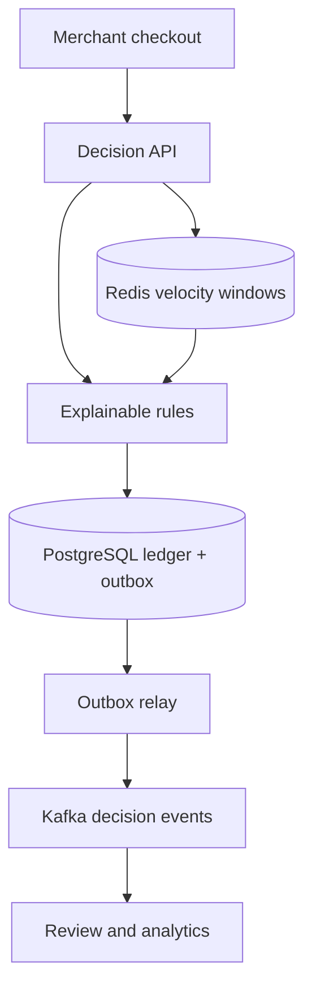

# Real-Time Fraud Decisioning Platform

A production-minded Java 17 service that makes explainable fraud decisions on the transaction path, persists immutable evidence, and reliably distributes decision events through Kafka.

## Why recruiters should care

This repository demonstrates backend engineering beyond CRUD: tenant-scoped idempotency, deterministic risk scoring, auditable reason codes, transactional messaging, concurrency-safe workers, schema migrations, and failure-aware API design.

## Current capabilities

- `APPROVE`, `REVIEW`, or `DECLINE` decisions with bounded risk scores
- Explainable rules for country mismatch, transaction value, card-not-present, and account age
- Distributed account, device, and IP velocity rules using Redis sorted sets
- Atomic sliding-window updates through a server-side Lua script
- Configurable `FAIL_REVIEW` or `FAIL_OPEN` behavior during Redis outages
- Redis circuit breaker with configurable failure threshold, timed recovery, and a single half-open probe
- Immutable tenant-specific rule-set drafts with controlled activation
- Database-enforced single active rule version per tenant
- Exact rule-set version recorded with every decision for audit replay
- Canonical SHA-256 request fingerprints
- Exact idempotent replay and `409 IDEMPOTENCY_CONFLICT` protection
- Tenant-isolated reads and idempotency keys
- PostgreSQL decision ledger with Flyway-managed constraints
- Transactional outbox and Kafka relay using `FOR UPDATE SKIP LOCKED`
- Automatic review-case creation for every `REVIEW` decision
- Exclusive analyst leases with expiry and safe reassignment
- Guarded approve/decline resolution with immutable audit history
- Transactional `FRAUD_REVIEW_RESOLVED` events
- Non-blocking shadow-model scoring beside the production rules
- Versioned shadow evidence with production-vs-candidate disagreement tracking
- Prometheus disagreement counters for safe promotion decisions
- Immutable verified labels from chargebacks, reviews, customer reports, and payment networks
- Payload-aware feedback idempotency plus source-reference deduplication
- Transactional feedback events and label/source metrics for training-data pipelines
- SHA-256 API-key authentication with constant-time verification
- Credential-bound tenant isolation and least-privilege endpoint scopes
- Structured `401` and `403` security responses; public health probes only
- OpenTelemetry traces for HTTP, decision, review, feedback, outbox, and Kafka paths
- W3C trace propagation to Kafka with trace/span/correlation IDs in logs
- OTLP export, configurable sampling, and a local Jaeger trace explorer
- Domain counters and latency histograms without high-cardinality customer tags
- Provisioned Prometheus alerts and Grafana dashboard for availability, p95 latency, review pressure, model drift, and outbox health
- k6 throughput profile with p95/p99 latency, error-rate, and dropped-iteration budgets
- Executable idempotency smoke test covering exact replay and conflicting key reuse
- Dual Kafka listeners for correct host and container-network routing
- Prometheus-ready Spring Boot Actuator endpoints
- Unit tests, Docker Compose, CI, and executable API examples

## Architecture



See [the architecture decisions](docs/architecture.md), [API examples](docs/api-examples.http), and [performance runbook](docs/performance.md).

## Run locally

```bash
mvn clean package
docker compose up --build
```

The API is available on `http://localhost:8080`; health is exposed at `/actuator/health`, Jaeger at `http://localhost:16686`, Prometheus at `http://localhost:9090`, and Grafana at `http://localhost:3000`. Local examples use `demo-merchant-key` and `demo-analyst-key`; production configuration accepts only their SHA-256 digests through environment variables.

## Production direction

This is the eleventh increment of a fourteen-step build. Planned work includes AWS deployment patterns and final production hardening.

## Technology

Java 17 · Spring Boot 3.5 · PostgreSQL 16 · Kafka · Redis · Flyway · Prometheus · Grafana · OpenTelemetry · k6 · Docker · GitHub Actions

## License

MIT
